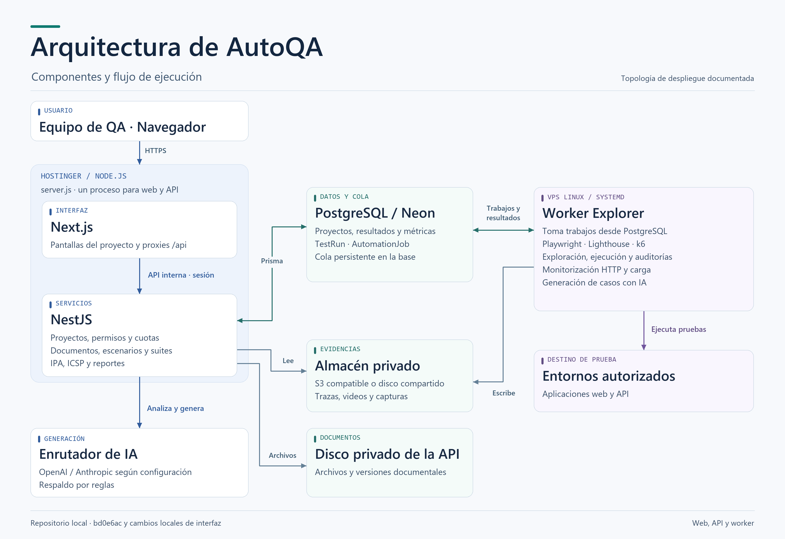

# Arquitectura de AutoQA

La web y la API comparten el proceso Node.js en el despliegue documentado. PostgreSQL conserva los datos y la cola que consume Explorer. Las guías de [despliegue](DEPLOY.md) y del [worker](EXPLORER_DEPLOY.md) detallan la configuración.

## Arquitectura objetivo
Web Next.js -> API NestJS -> PostgreSQL/Prisma. API publica trabajos a Redis/BullMQ; workers Playwright aislados ejecutan exploración y tests; almacenamiento S3-compatible conserva documentos/evidencias; motor IA enruta reglas -> modelo local -> proveedor externo. No implementar todos los servicios en la primera fase.

## Módulos
- `projects`: proyecto, entornos, autorización, alcance, configuraciones.
- `documents`: carga segura, parsing, indexación y versionado.
- `requirements`: requisitos, criterios, ambigüedades, vínculos.
- `roles`: roles y permisos; referencias a secretos, nunca secretos en texto plano.
- `exploration`: inventario por rol y cambios de UI.
- `scenarios`: casos estructurados y generación de código.
- `runs`: colas, workers, resultados y evidencias.
- `quality`: IPA, ICSP, métricas y recomendaciones.
- `ai-router`: caché, presupuestos, validación y escalado a modelos.
- `billing`: suscripciones y capacidad contratada (fase futura).

## Seguridad de navegación (bloqueante antes de exploración)
Validar URL y autorización; aplicar allowlist de hosts/rutas; resolver DNS y bloquear destinos privados, loopback, link-local y metadata; volver a comprobar en cada redirección y conexión; aislar red del worker, aplicar egress policy, rate limits y límites de tamaño/tiempo; restringir métodos/acciones destructivas; registrar auditoría. Nunca ejecutar código generado por IA sin validación y sandbox.

## IA
No enviar DOM completo ni documentos sensibles por defecto. Usar extracción estructurada, minimización, caché por hash, validación JSON schema y revisión de aserciones. La ejecución habitual de tests persistentes no requiere llamadas a LLM.

## Implementación documental local

Next.js reenvía las operaciones documentales del mismo origen al módulo NestJS con una clave de la instalación. La API verifica la clave y limita las operaciones al proyecto solicitado. El servicio usa PostgreSQL para metadatos, versiones, informes y trazabilidad. Los blobs permanecen en un directorio privado detrás de `DocumentStorage`, que define escritura, lectura y eliminación para un futuro adaptador S3. La validación de carga se realiza en workers Node.js con límites. El informe actual se identifica por el conjunto de versiones y el analizador utilizado. El [contrato documental](DOCUMENTS.md) detalla formatos, identificación de fuentes y puesta en marcha.

El proveedor `DocumentAnalysisProvider` recibe bloques con localizadores y devuelve hallazgos con evidencia. El proveedor activo es determinista. Los adaptadores futuros deben validar esquema, localizadores y citas contra los bloques suministrados, y aplicar minimización antes de llamar a un proveedor externo.

